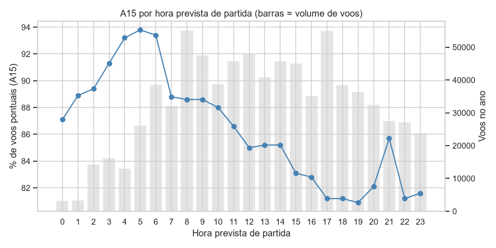
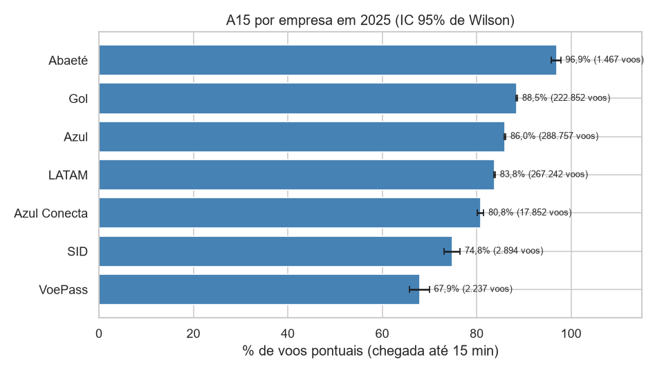
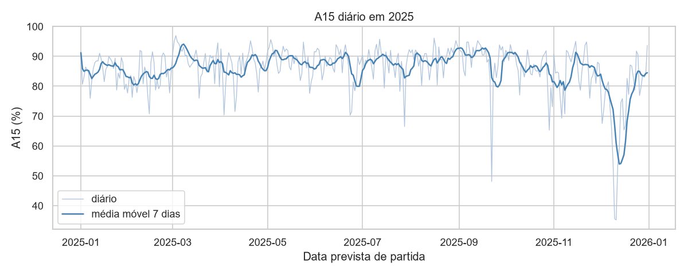
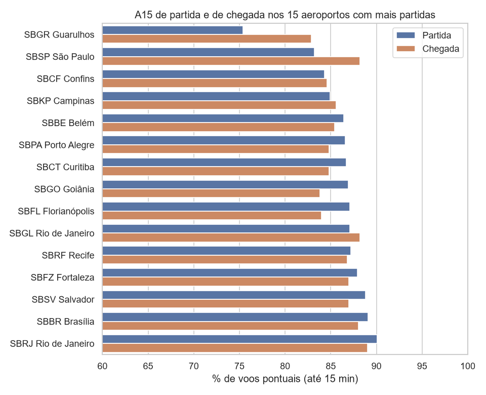
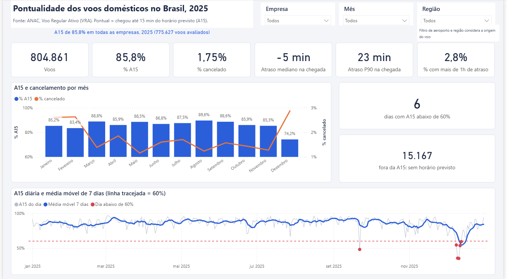
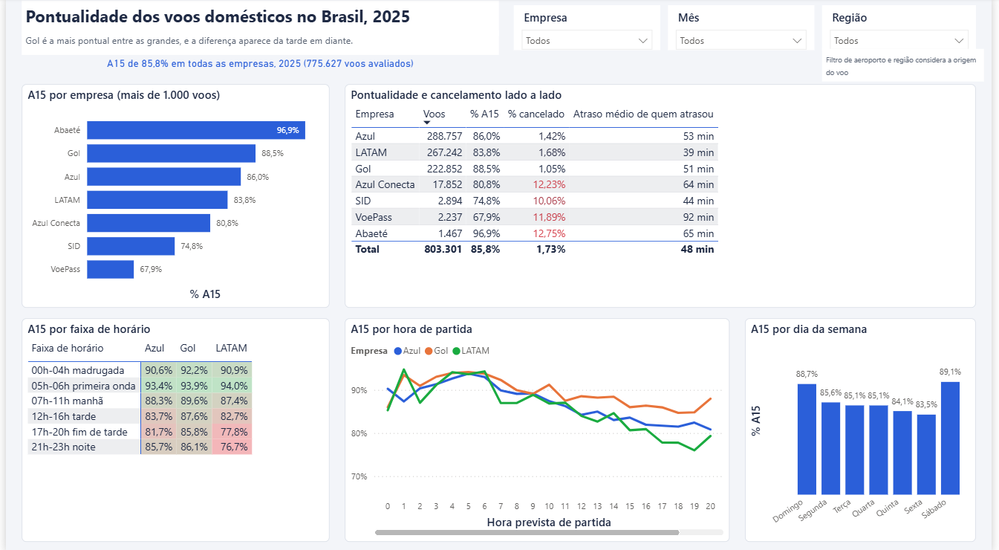
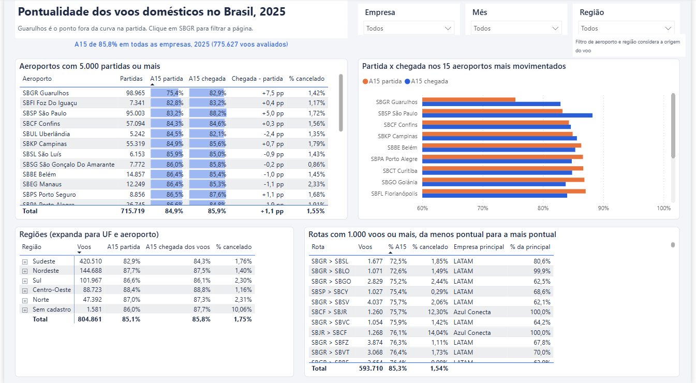

# Pontualidade dos voos domésticos no Brasil (2025)

Análise de 804.861 voos nacionais de 2025 com os dados abertos da ANAC. Montei um modelo estrela em SQL (DuckDB), respondi as perguntas de negócio em SQL e montei um painel em Power BI com três páginas.



## Perguntas

- Qual a pontualidade dos voos domésticos e como ela muda por empresa, aeroporto, horário e mês?
- A diferença entre as companhias é real ou é efeito de onde elas operam?
- O que explica os piores dias do ano?

Pontualidade aqui é o indicador A15, padrão do setor: voo que chegou até 15 minutos depois do horário previsto. Voo cancelado não entra no A15 (entra no % de cancelamento).

## Os dados

Base VRA (Voo Regular Ativo) da ANAC, um arquivo por mês, uma linha por voo, com horário previsto e real de partida e chegada. Usei só os voos de linha nacional (código N) de janeiro a dezembro de 2025. Para os nomes e a localização dos aeroportos, usei a lista de aeródromos públicos da ANAC.

Alguns cuidados que a base pediu:

- Horários chegam às vezes como o texto `null` e às vezes com fração de segundo (`06:55:00.100000000`). Um formato fixo de data descartava 20 mil voos sem avisar; troquei por conversão direta do DuckDB.
- 15.167 voos realizados não têm horário previsto (cerca de 2% de cada empresa, parecem voos extras). Sem previsto não existe atraso, então ficam fora do A15.
- 11 voos com mais de 24 horas de atraso ficaram marcados como suspeitos em vez de apagados.
- 11 aeroportos que aparecem nos voos não estão na lista pública da ANAC.
- A base não informa o fuso. Pelos voos internacionais os horários batem com o horário de Brasília, e foi isso que assumi.

Detalhes e dicionário da tabela fato em [data/README.md](data/README.md).

## Como está organizado

```
sql/01_staging.sql      leitura dos CSVs, tipos, filtro de voo nacional
sql/02_dimensoes.sql    dim_empresa, dim_aeroporto (UF e região), dim_data
sql/03_fato.sql         fato_voo: atraso em minutos, cancelado, pontual_15
sql/04_checagens.sql    contagens de qualidade impressas a cada carga
src/construir_base.py   roda os .sql em ordem e exporta o modelo em Parquet
notebooks/01_analise_pontualidade.ipynb   as análises, em SQL
dashboard/              painel .pbix, modelo do Power BI, medidas DAX e layout das páginas
```

## O que encontrei

### Visão geral

85,8% dos voos chegaram dentro do A15 e 1,75% foram cancelados. O atraso mediano de chegada é de -5 minutos, ou seja, o voo típico chega adiantado. A média é +1,1 min porque a cauda é longa: 10% dos voos chegam com mais de 23 minutos e 2,8% com mais de uma hora de atraso. Por isso o painel usa mediana e percentil 90, não média.

### Empresas



| Empresa | Voos | A15 | IC 95% (Wilson) | % cancelado |
|---|---|---|---|---|
| Gol | 222.852 | 88,5% | 88,4% a 88,6% | 1,05% |
| Azul | 288.757 | 86,0% | 85,9% a 86,2% | 1,42% |
| LATAM | 267.242 | 83,8% | 83,6% a 83,9% | 1,68% |
| Azul Conecta | 17.852 | 80,8% | 80,2% a 81,5% | 12,23% |

O qui-quadrado entre as três dá p praticamente zero, mas com centenas de milhares de voos qualquer diferença dá significativa. O V de Cramér é 0,054, um efeito pequeno. O que interessa é a diferença em pontos: Gol fica 4,7 pp acima da LATAM.

Parte dessa diferença é Guarulhos. A LATAM tem 75,1% de A15 nas partidas de Guarulhos e 86,3% no resto, praticamente igual à Azul. Tirando Guarulhos, a vantagem da Gol sobre a LATAM cai de 4,7 para 3,0 pp. Guarulhos é o pior aeroporto do país em partida (75,4%); o segundo pior já está em 82,8%.

### Horário

A pontualidade cai ao longo do dia: 93,8% às 5h, 80,9% às 19h, e o atraso médio de partida sai de -2,7 para +7,5 minutos. É o desenho do atraso que se acumula de um voo para o outro, mas a base não traz a matrícula do avião, então não dá para provar a cascata. Na primeira onda da manhã as três grandes empatam perto de 94%; no fim da tarde a LATAM perde 16,2 pontos, a Azul 11,7 e a Gol 8,1.

### Mês e piores dias



Dezembro fechou em 74,2% contra 86,9% no resto do ano. A queda se concentra em poucos dias: 10 e 11 de dezembro ficaram perto de 35% de A15, com 19,7% de cancelamento no dia 10, quase tudo em Congonhas, Guarulhos e Santos Dumont. Sem os dias 8 a 17, dezembro sobe para 81,2%. A média móvel de 7 dias chegou ao mínimo de 54,5% em 13/12. Fim de semana fica perto de 89%, dia útil entre 83,5% e 85,6%.

### Aeroportos e rotas



A maior rota do país, Santos Dumont x Congonhas, cancela 3,5% dos voos, o dobro da média. Entre as 232 rotas com pelo menos 1.000 voos, 7 das 10 piores saem de Guarulhos e a LATAM é a principal operadora em 8 delas.

## Painel em Power BI



O painel está em [dashboard/painel_pontualidade.pbix](dashboard/painel_pontualidade.pbix), já com os dados carregados. Abre no Power BI Desktop de setembro de 2025 em diante. São três páginas, todas com filtro de empresa, mês e região:

- Visão geral: os seis números do ano, A15 e cancelamento por mês e a série diária com média móvel de 7 dias. Os 6 dias abaixo de 60% aparecem marcados em vermelho.
- Empresas e horários: ranking, tabela com A15 e cancelamento lado a lado, matriz de faixa de horário por empresa e A15 por hora de partida.
- Aeroportos e rotas: partida e chegada de cada aeroporto, regiões com drill até o aeroporto e as rotas da menos para a mais pontual.





O Power BI lê os parquets de `data/modelo/` pelo parâmetro `PastaModelo`. Para atualizar a partir do seu clone, rode `src/construir_base.py`, troque o parâmetro em Transformar dados > Editar parâmetros para o caminho da pasta `data/modelo/` (terminando em barra) e clique em Atualizar.

Em [dashboard/](dashboard/) também estão:

- [modelo.md](dashboard/modelo.md): relações, hierarquias e o tratamento das duas chaves de aeroporto (origem ativa, destino inativa com `USERELATIONSHIP`).
- [medidas.dax](dashboard/medidas.dax): 24 medidas (A15, % cancelado, mediana e P90 do atraso, A15 de partida e de chegada por aeroporto, variação mensal, média móvel de 7 dias, dias abaixo de 60%, título dinâmico).
- [layout.md](dashboard/layout.md): três páginas (visão geral, empresas e horários, aeroportos e rotas).

## Limitações

- A base não tem o motivo do atraso (o campo de justificativa vem "N/A" nos 1.005.807 registros de 2025), então não separo clima, tráfego aéreo ou problema da companhia.
- Sem a matrícula da aeronave, o efeito cascata ao longo do dia é uma leitura do padrão, não uma medida.
- A comparação entre empresas não controla rota, horário e aeroporto ao mesmo tempo. O caso de Guarulhos mostra que isso pesa.
- O fuso horário é suposição (Brasília).

## Como rodar

```bash
python -m venv .venv
.venv\Scripts\activate        # Linux/Mac: source .venv/bin/activate
pip install -r requirements.txt

python data/baixar_dados.py   # 12 arquivos, ~140 MB
python src/construir_base.py  # cria data/voos.duckdb e data/modelo/*.parquet
jupyter notebook notebooks/01_analise_pontualidade.ipynb
```

Testado com Python 3.12 e DuckDB 2.0.

## Fonte

ANAC, dados abertos, Voo Regular Ativo (VRA) 2025 e lista de aeródromos públicos: https://sistemas.anac.gov.br/dadosabertos/
